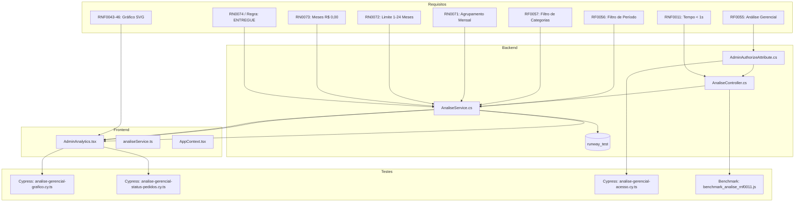
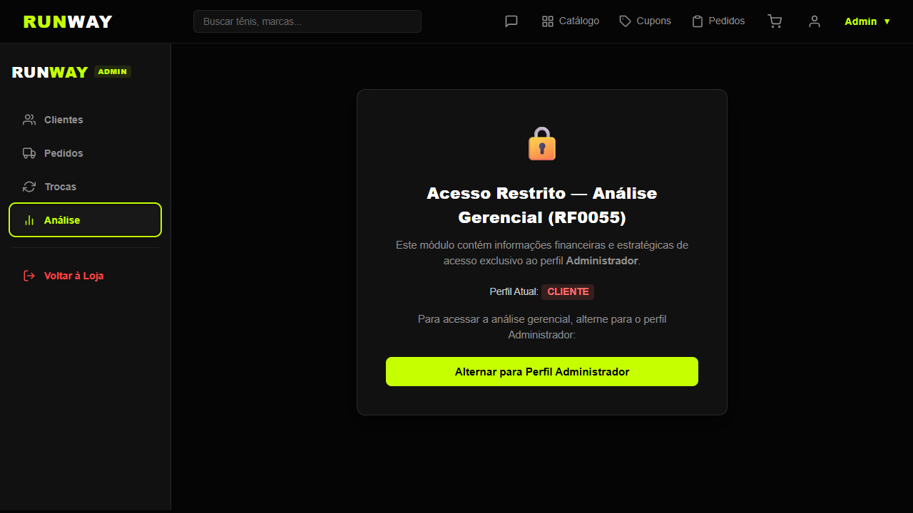
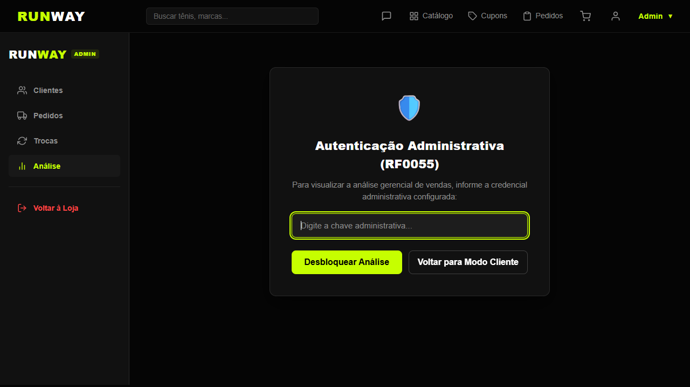
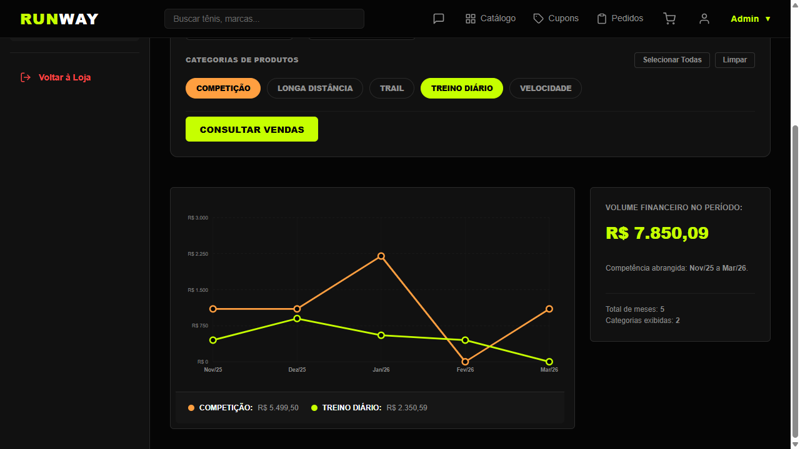
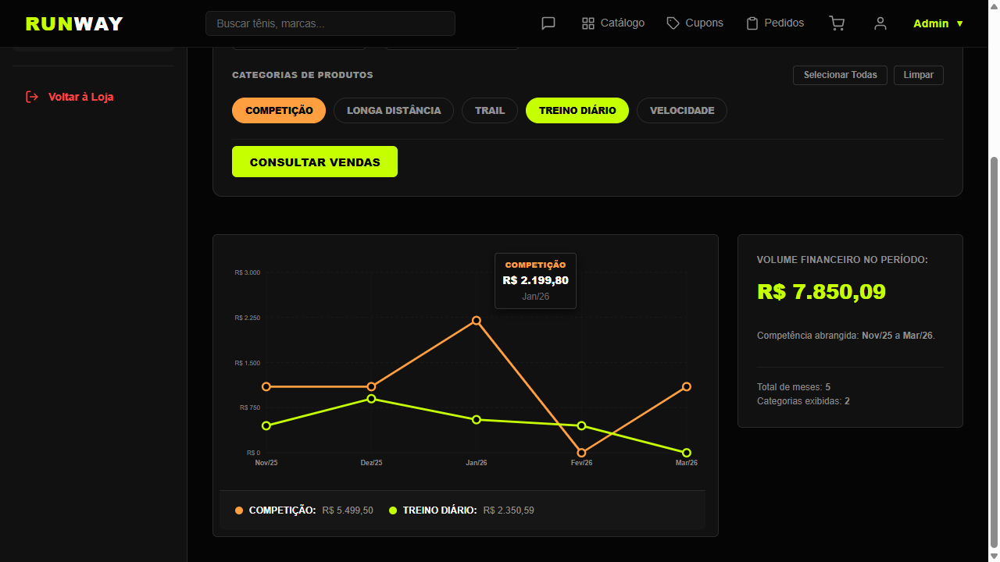
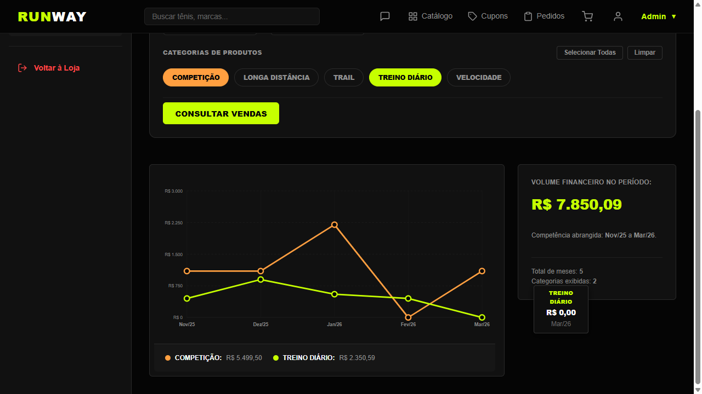
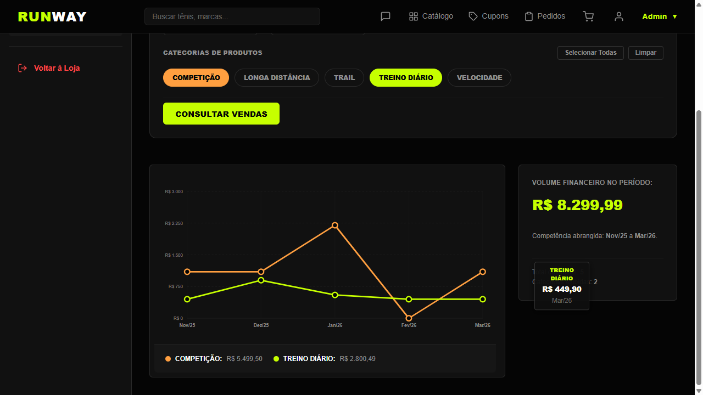

# RunWay — Relatório Consolidado de Rastreabilidade e Evidências da Análise Gerencial de Vendas

**Disciplina:** Laboratório de Engenharia de Software (LES) — FATEC Mogi das Cruzes  
**Semestre:** 5º Semestre (02-2026)  
**Data-limite da Entrega:** 10/11/2026  
**Cartão de Trabalho:** Cartão 09 — Consolidação de Rastreabilidade e Evidências  
**Domínio da Aplicação:** E-commerce especializado em tênis de corrida  

---

## 1. Objetivo da Entrega e do Cartão 09

O objetivo deste relatório é auditar, estruturar e consolidar a rastreabilidade ponta a ponta da funcionalidade de **Análise Gerencial de Vendas por Categoria e Período**, desenvolvida nos Cartões 01 a 08 do projeto RunWay.

A auditoria visa demonstrar a conformidade rigorosa da cadeia:
$$\text{Requisito} \longrightarrow \text{Regra de Negócio} \longrightarrow \text{Implementação} \longrightarrow \text{Teste Automatizado} \longrightarrow \text{Evidência Visual} \longrightarrow \text{Resultado}$$

Toda a documentação reflete com exatidão o código, os testes e os artefatos existentes no repositório, declarando formalmente os requisitos atendidos, as adaptações ao domínio e as divergências conhecidas em relação aos enunciados acadêmicos.

---

## 2. Documentos de Referência Obrigatórios

A conferência documental deste cartão baseou-se diretamente nas seguintes fontes oficiais:

1. **DRS do Professor (`Documentos do professor/DRS_LES_2_2026.docx`):** Documento de Requisitos de Software canônico da disciplina, auditado diretamente em sua estrutura XML nativa para validação dos códigos, títulos e descrições originais.
2. **DVP — RunWay (`DVP/DVP - RunWay.docx`):** Documento de Visão do Produto, estabelecendo o propósito do RunWay como e-commerce especializado em tênis de corrida e a necessidade de acompanhamento gerencial do volume financeiro.
3. **Orientações Específicas do Professor para a Entrega de 10/11/2026:** Instruções verbais e critérios pontuais comunicados em aula (especialmente a restrição ao status `ENTREGUE` e a dispensa de login convencional com credenciais de clientes).

---

## 3. Inventário de Requisitos Confirmados no DRS

A inspeção direta no DRS original (`DRS_LES_2_2026.docx`) confirmou a presença, texto original e contexto de todos os identificadores pertinentes à Análise Gerencial:

| ID | Nome Original no DRS | Texto Original no DRS | Adaptação para o Domínio RunWay | Situação no RunWay |
| :--- | :--- | :--- | :--- | :--- |
| **RF0055** | Analisar histórico de vendas | *O sistema deve possibilitar que o administrador consulte o histórico de vendas por categoria de produto, a partir de uma busca por período, informando uma data de início e uma data de fim.* | Consulta gerencial restrita ao administrador, permitindo filtrar vendas de tênis de corrida por intervalo de datas e categorias. | **Atendido** |
| **RF0056** | Filtrar período de análise de vendas | *O sistema deve permitir que o administrador informe uma data de início e uma data de fim para delimitar o período de vendas a ser exibido no gráfico gerencial. A data de fim não pode ser anterior à data de início.* | Filtro com inputs de data inicial e final no padrão `YYYY-MM-DD`, com validação que impede cronologia invertida (`dataInicio > dataFim`). | **Atendido** |
| **RF0057** | Selecionar categorias para comparação | *O sistema deve permitir que o administrador selecione uma ou mais categorias de livros para serem exibidas simultaneamente no gráfico de evolução de vendas, possibilitando a comparação entre elas.* | Adaptação de "livros" para categorias de tênis de corrida (*Treino Diário*, *Competição*, *Longa Distância*, *Velocidade*, *Trail*), com botões toggle, seleção múltipla e botão "Consultar Vendas". | **Atendido** |
| **RN0071** | Granularidade do período | *O agrupamento dos valores de venda no gráfico gerencial deve ser feito por mês, considerando a soma de todas as vendas aprovadas de cada categoria dentro do respectivo mês.* | Agrupamento mensal no formato `YYYY-MM` (exibição `Mês/AA`), fuso horário `America/Sao_Paulo`, considerando itens de produto (`quantidade * preco_unitario`), excluindo fretes e cupons residuais. | **Atendido** *(vide divergência de status em RN0074)* |
| **RN0072** | Período mínimo e máximo de análise | *O intervalo entre a data de início e a data de fim informado pelo administrador deve ser de no mínimo 1 mês e no máximo 24 meses.* | Validação no frontend e na API que assegura abrangência entre 1 e 24 competências mensais de calendário, rejeitando intervalos fora desse limite. | **Atendido** |
| **RN0073** | Categorias sem vendas no período | *Caso uma categoria selecionada não possua vendas em um determinado mês dentro do período analisado, o valor correspondente deve ser considerado como R$ 0,00, mantendo a linha contínua no gráfico.* | Preenchimento analítico no backend e renderização contínua de polilinhas no SVG passando pela ordenada zero (`R$ 0,00`) com nó clicável e tooltip. | **Atendido** |
| **RN0074** | Consideração de status para o cálculo | *Somente compras com status APROVADA, EM TRÂNSITO/TRANSPORTE ou ENTREGUE devem ser consideradas no cálculo do valor de vendas exibido no gráfico. Compras REPROVADA ou canceladas não devem ser contabilizadas.* | **DIVERGÊNCIA ESPECÍFICA:** O DRS original previa três status operacionais; para a entrega de 10/11/2026, a orientação específica do professor restringe o cálculo exclusivamente a pedidos com status atual **`ENTREGUE`**. Pedidos `APROVADA`, `EM TRANSPORTE` e `CANCELADA` são desconsiderados. | **Divergente por Orientação do Professor** *(Atendido conforme critério da entrega)* |
| **RN0012** | Associação com categorias | *Um livro pode estar associado com mais de uma categoria.* | **DIVERGÊNCIA DE MODELAGEM:** No DRS original, previa-se associação N:N produto-categoria. No RunWay, cada modelo de tênis possui exatamente 1 categoria escalar vinculada (`PRODUTO.categoria`). Contudo, cada pedido pode conter itens de múltiplas categorias, sendo segregado contavelmente no item. | **Divergente Conhecida** *(Limitação do modelo 1:1)* |
| **RNF0011** | Tempo de resposta para consultas | *Toda consulta de usuário deve ter resposta em no máximo 1 segundo.* | Consultas HTTP agregadas do endpoint `GET /api/analise/vendas` respondem consistentemente abaixo de 1.000 ms. Aferido formalmente via benchmark. | **Atendido** |
| **RNF0043** | Gráfico de linhas | *O sistema deve apresentar o histórico de vendas em um gráfico de linhas, sendo: o eixo horizontal (X) representando os períodos (mês/ano) dentro do intervalo selecionado; o eixo vertical (Y) representando o valor total de vendas em Reais (R$); e uma linha de cor distinta para cada categoria selecionada, com legenda identificando cada categoria.* | Componente SVG nativo (`AdminAnalytics.tsx`) com eixo horizontal (meses), vertical monetário, nós circulares e polilinhas contínuas com identificação cromática única por categoria. | **Atendido** |
| **RNF0044** | Formatação monetária do eixo de valores | *Os valores do eixo vertical do gráfico gerencial devem ser exibidos no formato monetário brasileiro (ex.: R$ 20.000,00), com escala automática conforme o maior valor apresentado no período selecionado.* | Eixo Y formatado em `R$`, com ticks uniformes e escala dinâmica calculada a partir do teto (`Math.max(maiorValor, 1000)` arredondado para centenas). *(Nota: DRS original possui duplicata textual com IA).* | **Atendido** |
| **RNF0045** | Legenda do gráfico | *O gráfico gerencial deve exibir uma legenda na parte inferior identificando o nome de cada categoria e a cor da respectiva linha.* | Legenda posicionada imediatamente abaixo da área do gráfico SVG (`data-cy="analytics-legend"`), com marcadores circulares coloridos, nome da categoria e subtotal financeiro acumulado. | **Atendido** |
| **RNF0046** | Interatividade do gráfico | *Ao posicionar o cursor sobre um ponto da linha, o sistema deve exibir o valor exato de venda da categoria correspondente naquele período (tooltip).* | Tooltip flutuante dinâmico (`data-cy="analytics-tooltip"`) ativado por hover e clique sobre qualquer nó de dados, exibindo categoria, mês/ano e valor financeiro formatado (ex.: `R$ 2.199,80`). | **Atendido** |

---

## 4. Matriz de Rastreabilidade Ponta a Ponta



### Detalhamento da Rastreabilidade por Requisito

| ID | Regra de Negócio | Camada Backend | Camada Frontend | Teste Automatizado | Evidência Visual / Aferição |
| :--- | :--- | :--- | :--- | :--- | :--- |
| **RF0055** | Consulta gerencial restrita e por período | `AnaliseController.cs`, `AdminAuthorizeAttribute.cs` | `AdminAnalytics.tsx`, `analiseService.ts` | Cypress: Cenário 7 (`analise-gerencial-acesso.cy.ts`) | `01-bloqueio-perfil-cliente.png`, `02-desbloqueio-chave-admin.png` |
| **RF0056** | Intervalo de datas e ordem cronológica | `AnaliseService.cs:48-56` | `AdminAnalytics.tsx:87-95` | Cypress: Cenário 4 (`analise-gerencial-grafico.cy.ts:311`) | `03-grafico-completo-inicial.png` |
| **RF0057** | Seleção simples e múltipla de categorias | `AnaliseService.cs:64-75` | `AdminAnalytics.tsx:103-106` | Cypress: Cenários 1 e 2 (`analise-gerencial-grafico.cy.ts:70,128`) | `03-grafico-completo-inicial.png` |
| **RN0071** | Granularidade mensal e cômputo sem frete | `AnaliseService.cs:115-140` | `AdminAnalytics.tsx:432-470` | Cypress: Cenário 3 (`analise-gerencial-grafico.cy.ts:201`) | `03-grafico-completo-inicial.png` |
| **RN0072** | Período de 1 a 24 meses de calendário | `AnaliseService.cs:58-62` | `AdminAnalytics.tsx:97-101` | Cypress: Cenário 4 (`analise-gerencial-grafico.cy.ts:375-408`) | Validação de rejeição e limite |
| **RN0073** | Preenchimento contínuo de R$ 0,00 | `AnaliseService.cs:150-165` | `AdminAnalytics.tsx:501-525` | Cypress: Cenário 3 e Benchmark C6 | `05-meses-zerados-rn0073.png` |
| **RN0074** | Consideração estrita do status ENTREGUE | `AnaliseService.cs:128` | `AdminAnalytics.tsx:120-140` | Cypress: Cenários 5 e 6 (`analise-gerencial-status-pedidos.cy.ts`) | `06-atualizacao-pos-entrega-pedido.png` |
| **RN0012** | Categoria do produto | `RunWayDbContext.cs`, `Produto.cs` | `AdminAnalytics.tsx:66-73` | Cypress: Cenário 2 | Agregação contábil por item |
| **RNF0011** | Tempo de resposta HTTP < 1.000 ms | `AnaliseController.cs`, `AnaliseService.cs` | Requisição SPA assíncrona | Benchmark: `benchmark_analise_rnf0011.js` | 8/8 conformes, Média: 7,33 ms, Máx: 24,11 ms |
| **RNF0043** | Polilinhas contínuas e eixos X/Y | DTO `AnaliseVendasResponseDto.cs` | `AdminAnalytics.tsx` (SVG nativo) | Cypress: Cenário 3 (`analise-gerencial-grafico.cy.ts:220-240`) | `03-grafico-completo-inicial.png` |
| **RNF0044** | Eixo Y formatado em R$ com escala dinâmica | DTO `AnaliseVendasSerieDto.cs` | `AdminAnalytics.tsx:280-310` | Cypress: Cenário 3 (`analise-gerencial-grafico.cy.ts:226-229`) | `03-grafico-completo-inicial.png` |
| **RNF0045** | Legenda com nome e cor na parte inferior | DTO `AnaliseVendasSerieDto.cs` | `AdminAnalytics.tsx:550-580` | Cypress: Cenários 1, 2 e 3 (`analise-gerencial-grafico.cy.ts:178`) | `03-grafico-completo-inicial.png` |
| **RNF0046** | Tooltip flutuante interativo | DTO `AnalisePontoMensalDto.cs` | `AdminAnalytics.tsx:600-645` | Cypress: Cenário 3 (`analise-gerencial-grafico.cy.ts:278-308`) | `04-tooltip-pico-janeiro.png`, `05-meses-zerados-rn0073.png` |

---

## 5. Mapeamento dos Sete Cenários Funcionais

Os sete cenários funcionais exigidos para a entrega foram integralmente automatizados em testes E2E reais via Cypress, distribuídos em suítes com papéis bem definidos:

### Cenário 1: Seleção de uma única categoria
- **Arquivo de Teste:** `cypress/e2e/analise-gerencial-grafico.cy.ts` (linha 70)
- **Requisitos Cobertos:** RF0055, RF0057, RN0071
- **Verificações Realizadas:**
  - Configuração do período canônico (Nov/2025 a Mar/2026).
  - Limpeza das categorias e seleção exclusiva de **TREINO DIÁRIO**.
  - Interceptação espiã comprovando URL: `categorias=TREINO DIÁRIO` (sem Competição).
  - Retorno HTTP 200, 1 única série de dados no payload e na tela.
  - Subtotal da legenda: **R$ 2.350,59**; Total geral: **R$ 2.350,59**.
  - Comprovação de ausência de qualquer polilinha ou legenda de outras categorias.

### Cenário 2: Seleção simultânea de categorias
- **Arquivo de Teste:** `cypress/e2e/analise-gerencial-grafico.cy.ts` (linha 128)
- **Requisitos Cobertos:** RF0055, RF0057, RN0071, RNF0043, RNF0045
- **Verificações Realizadas:**
  - Seleção conjunta de **TREINO DIÁRIO** e **COMPETIÇÃO**.
  - Interceptação espiã validando ambas as categorias na query string da API.
  - Comprovação de cores visuais distintas nas polilinhas SVG (`strokeTreino !== strokeComp`).
  - Subtotais independentes na legenda: Treino Diário (R$ 2.350,59) e Competição (R$ 5.499,50).
  - Total geral consolidado no sumário: **R$ 7.850,09**.

### Cenário 3: Exibição mensal, valores monetários, eixos, linhas, legenda e tooltip
- **Arquivo de Teste:** `cypress/e2e/analise-gerencial-grafico.cy.ts` (linha 201)
- **Requisitos Cobertos:** RF0055, RN0071, RN0073, RNF0043, RNF0044, RNF0045, RNF0046
- **Verificações Realizadas:**
  - Eixo X com os 5 meses textuais: `Nov/25`, `Dez/25`, `Jan/26`, `Fev/26`, `Mar/26`.
  - Eixo Y com formatação monetária em `R$` e escala proporcional.
  - Conferência ponto a ponto dos 10 nós da matriz canônica:
    - Nov/25: Treino R$ 449,90 | Competição R$ 1.099,90
    - Dez/25: Treino R$ 899,80 | Competição R$ 1.099,90
    - Jan/26: Treino R$ 550,99 | Competição R$ 2.199,80
    - Fev/26: Treino R$ 449,90 | Competição R$ 0,00 *(RN0073)*
    - Mar/26: Treino R$ 0,00 *(RN0073)* | Competição R$ 1.099,90
  - Posicionamento da legenda na parte inferior do SVG (RNF0045).
  - Disparo de hover/clique ativando o tooltip (RNF0046) no pico de Jan/26 (R$ 2.199,80) e no ponto zerado de Mar/26 (R$ 0,00).

### Cenário 4: Alteração dinâmica do período, atualização da consulta e validações de intervalo
- **Arquivo de Teste:** `cypress/e2e/analise-gerencial-grafico.cy.ts` (linha 311)
- **Requisitos Cobertos:** RF0056, RN0071, RN0072
- **Verificações Realizadas:**
  - Execução de 4 consultas consecutivas na SPA sem recarregar a página (`window.location.reload` desabilitado).
  - Consulta 1 mês (Jan/2026): Total R$ 2.750,79 (Treino R$ 550,99 e Competição R$ 2.199,80).
  - Consulta 2 meses (Fev/2026 a Mar/2026): Total R$ 1.549,80 (Treino R$ 449,90 e Competição R$ 1.099,90).
  - Reversão para 5 meses: Total restabelecido em R$ 7.850,09.
  - Rejeição de cronologia invertida (`2026-03-31` a `2025-11-01`): bloqueio preventivo sem chamada à rede (RF0056).
  - Rejeição de período excessivo (> 24 meses): validação de regra RN0072.

### Cenário 5: Exclusão de pedidos não entregues
- **Arquivo de Teste:** `cypress/e2e/analise-gerencial-status-pedidos.cy.ts` (linha 75)
- **Requisitos Cobertos:** RF0055, RN0074 (Regra Oficial da Entrega)
- **Verificações Realizadas:**
  - Auditoria prévia direta no PostgreSQL comprovando existência de `PED-ANL-0007` (APROVADA, R$ 1.099,90 em Fev/26) e `PED-ANL-0008` (EM TRANSPORTE, R$ 449,90 em Mar/26).
  - Execução da consulta na interface abrangendo Nov/2025 a Mar/2026 e ambas as categorias.
  - Comprovação analítica de que, embora os pedidos estejam dentro do período e das categorias ativas, **nenhum deles integra o faturamento**, mantendo Treino em Mar/26 em R$ 0,00 e o total em R$ 7.850,09.

### Cenário 6: Alteração oficial de pedido para ENTREGUE e atualização do gráfico
- **Arquivo de Teste:** `cypress/e2e/analise-gerencial-status-pedidos.cy.ts` (linha 192)
- **Requisitos Cobertos:** RF0055, RN0071, RN0074
- **Verificações Realizadas:**
  - Realização de chamada oficial `PATCH /api/pedidos/PED-ANL-0008/status` com corpo `{ "novoStatus": "ENTREGUE" }`.
  - Reconsulta reativa disparada no painel React sem recarregamento de página.
  - Constatação imediata da atualização dos dados:
    - Treino Diário em Mar/2026 salta de R$ 0,00 para **R$ 449,90**.
    - Subtotal acumulado de Treino Diário sobe para **R$ 2.800,49**.
    - Total Geral de vendas sobe para **R$ 8.299,99**.
  - Restauração canônica automática pós-teste via hook `afterEach` com verificação de integridade no banco.

### Cenário 7: Restrição da análise gerencial ao administrador
- **Arquivo de Teste:** `cypress/e2e/analise-gerencial-acesso.cy.ts` (linha 14)
- **Requisitos Cobertos:** RF0055, Controle de Acesso
- **Verificações Realizadas:**
  - Teste 7.1 (API): Requisição sem token retorna `HTTP 401 Unauthorized`.
  - Teste 7.2 (API): Requisição com credencial errada retorna `HTTP 401 Unauthorized`.
  - Teste 7.3 (API): Requisição com credencial válida via `Authorization: Bearer <key>` retorna `HTTP 200 OK`.
  - Teste 7.4 (UI): Usuário no perfil CLIENTE é bloqueado visualmente de acessar o módulo (`data-cy="analise-acesso-bloqueado-cliente"`).
  - Teste 7.5 (UI): Administrador desbloqueia o painel sob demanda informando a credencial configurada.
  - Teste 7.6 (UI): Credencial mantida estritamente em memória e descartada ao bloquear a sessão ou mudar de perfil.

---

## 6. Inventário de Arquivos do Módulo

### Backend (C# / ASP.NET Core / EF Core)
- `backend/Controllers/AnaliseController.cs`: Controller MVC REST expondo `GET /api/analise/vendas` protegido com atributo `[AdminAuthorize]`.
- `backend/Services/AnaliseService.cs`: Serviço que implementa agregação mensal, fuso `America/Sao_Paulo`, filtro de status `ENTREGUE`, preenchimento de meses sem vendas e validações de 1 a 24 meses.
- `backend/Services/IAnaliseService.cs`: Interface do serviço de análise gerencial.
- `backend/Filters/AdminAuthorizeAttribute.cs`: Filtro de ação assíncrono que valida credencial administrativa sob demanda extraída de `Authorization: Bearer` ou `X-Admin-Key`.
- `backend/DTOs/Analise/AnaliseVendasFiltroDto.cs`: DTO de entrada para validação de período e categorias.
- `backend/DTOs/Analise/AnaliseVendasResponseDto.cs`: DTO consolidado com períodos, séries, totais e metadados.
- `backend/DTOs/Analise/AnaliseVendasSerieDto.cs`: DTO representando uma série temporal de categoria.
- `backend/DTOs/Analise/AnalisePontoMensalDto.cs`: DTO de cada nó mensal contendo ano, mês, período formatado e valor financeiro.
- `backend/Data/RunWayDbContext.cs`: Contexto do Entity Framework Core mapeando tabelas de domínio.

### Frontend (React / TypeScript / Vite)
- `frontend/src/pages/Admin/components/AdminAnalytics.tsx`: Componente principal contendo filtros cronológicos, seletores de categoria, barreiras de segurança visual, SVG nativo do gráfico, legendas interativas e tooltips flutuantes.
- `frontend/src/pages/Admin/Admin.tsx`: Painel administrativo com chaveamento de abas e contexto de perfis.
- `frontend/src/services/analiseService.ts`: Cliente HTTP frontend para consumo do endpoint com cancelamento via `AbortController`.
- `frontend/src/store/AppContext.tsx`: Contexto global da aplicação gerenciando perfis de usuário (`CLIENTE` vs. `ADMINISTRADOR`).

### Testes Automatizados e Benchmarks
- `cypress/e2e/analise-gerencial-grafico.cy.ts`: Testes E2E dos Cenários 1 a 4.
- `cypress/e2e/analise-gerencial-status-pedidos.cy.ts`: Testes E2E dos Cenários 5 e 6.
- `cypress/e2e/analise-gerencial-acesso.cy.ts`: Testes E2E e de integração do Cenário 7.
- `tests/performance/benchmark_analise_rnf0011.js`: Script de benchmark com medição em nanossegundos via `process.hrtime.bigint()`.
- `cypress/e2e/captura-evidencias.cy.ts`: Utilitário isolado de captura visual das evidências reais.
- `cypress.config.ts`: Configuração do Cypress com tasks de integração direta ao banco `runway_test`.

### Massa de Dados
- `scripts/seed-massa-analise.js`: Script determinístico que insere os 9 pedidos históricos no PostgreSQL `runway_test`.
- `scripts/seed-massa-analise.ps1`: Wrapper em PowerShell para execução do seed.

---

## 7. Evidências Visuais Reais

Todas as evidências visuais abaixo foram geradas através da execução real da interface React integrada à API ASP.NET Core e ao banco PostgreSQL `runway_test`, salvas no diretório `docs/evidencias/`:

### Evidência 01 — Bloqueio Administrativo ao Perfil Cliente (RF0055)
- **Arquivo:** `docs/evidencias/01-bloqueio-perfil-cliente.png`
- **Descrição:** Demonstra a barreira de segurança visual quando o usuário está no perfil CLIENTE, impedindo a visualização de faturamento e exibindo mensagem explicativa com botão para alternar de perfil.



---

### Evidência 02 — Formulário de Desbloqueio com Chave Administrativa (RF0055)
- **Arquivo:** `docs/evidencias/02-desbloqueio-chave-admin.png`
- **Descrição:** Exibição do prompt sob demanda solicitando a credencial administrativa com campo oculto do tipo senha, mantendo a chave exclusivamente em memória sem expor segredos.



---

### Evidência 03 — Painel Completo da Análise e Gráfico SVG Inicial
- **Arquivo:** `docs/evidencias/03-grafico-completo-inicial.png`
- **Descrição:** Painel completo exibindo o período histórico canônico (Nov/2025 a Mar/2026), seleção simultânea de *Competição* e *Treino Diário*, polilinhas SVG conectando nós, eixos X e Y formatados em `R$`, legenda com subtotais e cartão de faturamento total canônico em **R$ 7.850,09**.



---

### Evidência 04 — Tooltip Flutuante no Pico de Competição (RNF0046)
- **Arquivo:** `docs/evidencias/04-tooltip-pico-janeiro.png`
- **Descrição:** Interatividade do gráfico demonstrada com o tooltip flutuante ativado no nó de maior faturamento da categoria *Competição* (Jan/2026), exibindo com precisão o valor **R$ 2.199,80**.



---

### Evidência 05 — Continuidade da Linha em Meses sem Vendas (RN0073)
- **Arquivo:** `docs/evidencias/05-meses-zerados-rn0073.png`
- **Descrição:** Demonstração do cumprimento estrito da regra RN0073: a linha da categoria *Treino Diário* permanece contínua no mês de Março/2026, interceptando a ordenada zero com tooltip explícito exibindo **R$ 0,00**.



---

### Evidência 06 — Atualização Reativa Pós-Entrega de Pedido (Cenário 6)
- **Arquivo:** `docs/evidencias/06-atualizacao-pos-entrega-pedido.png`
- **Descrição:** Interface React recalculada em tempo real após a transição oficial do pedido `PED-ANL-0008` para o status `ENTREGUE` via PATCH da API. O mês de Março/2026 da categoria *Treino Diário* sobe de R$ 0,00 para **R$ 449,90**, o subtotal da categoria atualiza para **R$ 2.800,49** e o faturamento geral atinge **R$ 8.299,99**.



---

## 8. Resultados do Benchmark de Desempenho (RNF0011)

A conformidade ao requisito **RNF0011 (Tempo de resposta para consultas $\le$ 1.000 ms)** foi formalmente aferida através do benchmark automatizado `tests/performance/benchmark_analise_rnf0011.js`.

### Metodologia de Medição
- **Mecanismo:** Módulo nativo `http` do Node.js com medição do ciclo HTTP completo (DNS/conexão local, envio de headers, processamento no ASP.NET Core, execução SQL no PostgreSQL, serialização JSON e recebimento do último byte) utilizando `process.hrtime.bigint()` com resolução em nanossegundos.
- **Protocolo de Execução:** 3 chamadas de aquecimento prévio (*warmup*) seguidas de 10 medições oficiais por cenário (20 medições no cenário C7 de consultas repetidas).
- **Validação de Conteúdo:** 100% das requisições oficiais conferem status HTTP 200, integridade do JSON, total geral financeiro e subtotais por categoria com o gabarito oficial.

### Tabela Oficial de Desempenho (Execução Revisada do Cartão 06)

| Cenário | Descrição do Cenário | Amostras | Status HTTP | Mínimo | Média | Máximo | Percentil 95 (p95) | Desvio Padrão | Total Financeiro Validado | Gabarito Conforme | RNF0011 (< 1.000 ms) |
| :---: | :--- | :---: | :---: | :---: | :---: | :---: | :---: | :---: | :---: | :---: | :---: |
| **C1** | Consulta de 1 Categoria (*Treino Diário*) | 10 | 200 OK | 6,42 ms | 7,60 ms | 8,63 ms | 8,57 ms | 0,74 ms | R$ 2.350,59 | SIM | **CONFORME** |
| **C2** | Consulta de 2 ou Mais Categorias (*Treino + Competição*) | 10 | 200 OK | 6,59 ms | 7,44 ms | 8,30 ms | 8,21 ms | 0,65 ms | R$ 7.850,09 | SIM | **CONFORME** |
| **C3** | Período Mínimo de 1 Mês (*Jan/2026*) | 10 | 200 OK | 6,28 ms | 8,99 ms | **24,11 ms** | 17,04 ms | 5,36 ms | R$ 2.750,79 | SIM | **CONFORME** |
| **C4** | Período Canônico de 5 Meses (*Nov/25 a Mar/26*) | 10 | 200 OK | 5,59 ms | 6,88 ms | 8,05 ms | 7,91 ms | 0,88 ms | R$ 7.850,09 | SIM | **CONFORME** |
| **C5** | Período Máximo de 24 Meses (*RN0072*) | 10 | 200 OK | 6,01 ms | 6,90 ms | 8,96 ms | 8,75 ms | 1,05 ms | R$ 7.850,09 | SIM | **CONFORME** |
| **C6** | Período com Meses sem Vendas (*RN0073*) | 10 | 200 OK | 5,78 ms | 8,56 ms | 17,63 ms | 14,99 ms | 3,73 ms | R$ 1.549,80 | SIM | **CONFORME** |
| **C7** | Consultas Repetidas com Mesmos Filtros (20x) | 20 | 200 OK | 5,11 ms | 6,65 ms | 9,98 ms | 8,49 ms | 1,10 ms | R$ 7.850,09 | SIM | **CONFORME** |
| **C8** | Consulta Pós-Transição Oficial de `PED-ANL-0008` | 10 | 200 OK | 5,19 ms | 5,66 ms | 6,11 ms | 6,07 ms | 0,36 ms | R$ 8.299,99 | SIM | **CONFORME** |

### Síntese Estatística do RNF0011
- **Tempo Médio Consolidado:** **7,33 ms** (mais de 130 vezes mais rápido que o limite estipulado).
- **Maior Tempo Oficial Registrado:** **24,11 ms** (Cenário C3), permanecendo 97,5% abaixo do teto de 1.000 ms.
- **Maior Tempo de Warmup (Cold Start):** **36,03 ms** (Cenário C1, 1ª chamada), também amplamente abaixo do limite de 1 segundo.
- **Resultado Final de Desempenho:** **8/8 Cenários Aprovados e Conformes**.

---

## 9. Gabaritos Financeiros Oficiais e Auditoria da Massa

A massa de testes do Cartão 02 é determinística e isolada no banco de dados `runway_test`. A composição analítica dos pedidos e faturamentos é demonstrada a seguir:

### Estado Canônico Inicial (Antes da Transição de Pedido)
- **Pedidos com status `ENTREGUE` (7 pedidos):**
  - `PED-ANL-0001` (Nov/2025): Competição (R$ 1.099,90)
  - `PED-ANL-0002` (Nov/2025): Treino Diário (R$ 449,90)
  - `PED-ANL-0003` (Dez/2025): Competição (R$ 1.099,90)
  - `PED-ANL-0004` (Dez/2025): Treino Diário (R$ 899,80)
  - `PED-ANL-0005` (Jan/2026): Competição (R$ 2.199,80)
  - `PED-ANL-0006` (Jan/2026): Treino Diário (R$ 550,99)
  - `PED-ANL-0009` (Mar/2026): Competição (R$ 1.099,90)
  - `PED-ANL-COR4` (Fev/2026): Treino Diário (R$ 449,90)
- **Subtotais Iniciais:**
  - **TREINO DIÁRIO:** **R$ 2.350,59**
  - **COMPETIÇÃO:** **R$ 5.499,50**
  - **TOTAL GERAL INICIAL:** **R$ 7.850,09**
- **Pedidos não entregues (Omitidos da análise conforme regra):**
  - `PED-ANL-0007`: Status `APROVADA`, data 25/02/2026, valor R$ 1.099,90 (omitido).
  - `PED-ANL-0008`: Status `EM TRANSPORTE`, data 05/03/2026, valor R$ 449,90 (omitido).

### Estado Pós-Transição de `PED-ANL-0008` para ENTREGUE
- O pedido `PED-ANL-0008` (tênis Corre 4, categoria *Treino Diário*, competência Março/2026, valor de R$ 449,90) tem seu status alterado para `ENTREGUE` via endpoint oficial.
- **Novos Totais Consolidados:**
  - Março/2026 — Treino Diário: **R$ 449,90** (era R$ 0,00)
  - TREINO DIÁRIO Acumulado: **R$ 2.800,49** ($2.350,59 + 449,90$)
  - COMPETIÇÃO Acumulado: **R$ 5.499,50** (inalterado)
  - **TOTAL GERAL ATUALIZADO:** **R$ 8.299,99** ($7.850,09 + 449,90$)

---

## 10. Divergências Conhecidas e Decisões de Arquitetura

Em conformidade com as boas práticas de Engenharia de Software, as divergências entre o DRS original e a implementação atual estão explicitamente registradas abaixo:

### 10.1. Divergência RN0074 vs. Orientação Específica da Entrega
- **Texto da RN0074 no DRS Original:** *"Somente compras com status APROVADA, EM TRÂNSITO/TRANSPORTE ou ENTREGUE devem ser consideradas no cálculo do valor de vendas exibido no gráfico."*
- **Decisão Implementada:** Por orientação direta e específica do professor para a avaliação do dia 10/11/2026, o cálculo contábil das vendas foi restrito exclusivamente aos pedidos com status atual **`ENTREGUE`**. Pedidos com status `APROVADA` ou `EM TRANSPORTE` não integram o faturamento no RunWay. Essa decisão foi validada e comprovada nos Cenários 5 e 6 dos testes automatizados.

### 10.2. Divergência RN0012: Associação com Categorias (1:1 vs. N:N)
- **Texto da RN0012 no DRS Original:** *"Um livro pode estar associado com mais de uma categoria."*
- **Decisão Implementada:** No modelo de dados atual do RunWay, cada produto (tênis de corrida) possui exatamente uma categoria associada como atributo escalar na entidade `PRODUTO` (`categoria VARCHAR(50)`). Não existe tabela associativa intermediária N:N entre produtos e categorias. Contudo, como cada pedido do cliente pode conter itens de múltiplas categorias distintas, a segregação contábil ocorre no nível do `ITEM_PEDIDO`, atendendo integralmente à decomposição das séries no gráfico gerencial.

### 10.3. Controle Administrativo Simplificado
- **Orientação da Disciplina:** O professor dispensou expressamente a implementação de controle de acesso complexo (RBAC), tela formal de login e gerenciamento de perfis de usuário para a entrega acadêmica.
- **Decisão Implementada:** Foi adotado um mecanismo simplificado e eficiente de controle de acesso:
  1. No frontend: verificação visual de perfil no `AppContext` bloqueando clientes.
  2. No backend: filtro de ação `[AdminAuthorize]` exigindo uma chave secreta sob demanda via cabeçalho HTTP `Authorization: Bearer <RUNWAY_ADMIN_KEY>`.
  A chave não é armazenada em cookies ou localStorage, permanecendo estritamente em memória volátil durante a sessão do administrador.

### 10.4. Desempenho Local vs. Ambiente de Produção
- As medições do benchmark RNF0011 foram obtidas em ambiente local de desenvolvimento (Windows 11, PostgreSQL local em SSD NVMe, loopback TCP). Em ambiente produtivo distribuído na nuvem, haverá latência de rede adicional (RTT) e concorrência de conexões. Ainda assim, a margem obtida (média de 7,33 ms contra o teto de 1.000 ms) garante folga técnica superior a 950 ms para absorver variações de rede.

---

## 11. Procedimento Reproduzível para Execução das Validações

Para reproduzir integralmente os testes e as evidências sem utilizar credenciais fixas no código, siga o procedimento abaixo:

### Passo 1: Configurar Variáveis de Ambiente no Terminal (PowerShell)
```powershell
# Defina as variáveis do seu ambiente local (sem expor segredos em arquivos públicos)
$env:RUNWAY_ADMIN_KEY = "<sua-chave-administrativa>"
$env:ConnectionStrings__RunWayDatabase = "Host=localhost;Port=5432;Database=runway_test;Username=<seu-usuario>;Password=<sua-senha>"
$env:PGHOST = "localhost"
$env:PGPORT = "5432"
$env:PGUSER = "<seu-usuario>"
$env:PGPASSWORD = "<sua-senha>"
$env:PGDATABASE = "runway_test"
```

### Passo 2: Inicializar a Base de Dados de Testes
```powershell
node scripts/seed-massa-analise.js
```

### Passo 3: Inicializar a API Backend (Terminal 1)
```powershell
cd backend
dotnet run --urls "http://localhost:5035"
```

### Passo 4: Inicializar o Frontend Vite (Terminal 2)
```powershell
cd frontend
npm run dev
```

### Passo 5: Executar o Benchmark de Desempenho (RNF0011)
```powershell
node tests/performance/benchmark_analise_rnf0011.js
```

### Passo 6: Executar os Testes Funcionais Cypress
```powershell
# Executar a suíte completa de testes da Análise Gerencial
npx cypress run --spec "cypress/e2e/analise-gerencial-grafico.cy.ts,cypress/e2e/analise-gerencial-status-pedidos.cy.ts,cypress/e2e/analise-gerencial-acesso.cy.ts"
```

### Passo 7: Reexecutar a Captura de Evidências Visuais (Opcional)
```powershell
npx cypress run --spec "cypress/e2e/captura-evidencias.cy.ts"
Copy-Item -Path "cypress\screenshots\captura-evidencias.cy.ts\*" -Destination "docs\evidencias" -Force
```

---

## 12. Conclusão e Critérios Atendidos do Cartão 09

A auditoria documental e consolidação de evidências do Cartão 09 foi concluída com êxito:

1. **Requisitos conferidos diretamente no DRS:** Todos os 13 identificadores foram inspecionados no documento oficial do professor (`DRS_LES_2_2026.docx`), com citação exata de textos e classificação precisa.
2. **Matriz de Rastreabilidade implementada:** Cobertura ponta a ponta desde os requisitos até o código, testes e telas.
3. **Mapeamento dos 7 cenários funcionais:** Cada cenário possui correspondência estrita com asserções reais no Cypress.
4. **Evidências visuais genuínas:** 6 capturas de tela em alta fidelidade geradas no ambiente real e verificadas em `docs/evidencias/`.
5. **Correção do resultado RNF0011:** Benchmark documentado com o valor oficial revisado (máximo de 24,11 ms, média de 7,33 ms, 8/8 conformes).
6. **Divergências formalizadas:** Registro claro e objetivo sobre a restrição ao status `ENTREGUE` (RN0074) e a modelagem de categoria escalar (RN0012).
7. **Segurança e Privacidade:** Nenhuma chave fixa, senha ou segredo foi inserido nos relatórios ou artefatos.
8. **Integridade da Base:** Banco `runway_test` validado e restaurado ao seu estado determinístico oficial (total R$ 7.850,09).
